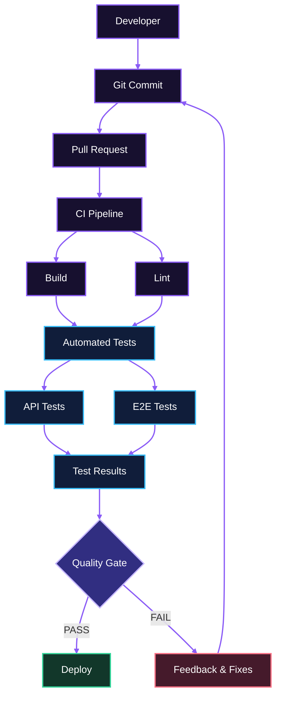

  

 

**[🚀 Abrir o portfólio ao vivo →](https://jvferrer.github.io/Portifolio_JoaoVitor/)**

**Analista de QA | Automação de Testes | Web & API | IA aplicada a QA**

Cypress · Playwright · Robot Framework · Selenium · k6 · Postman · SQL · LLMs · MCP

Santo André, SP · Brasil

 

  

 

  

 

  

---

# 🧪 Sobre mim

Sou **Analista de QA**, com atuação em Quality Assurance, testes manuais e automação, voltada à validação de aplicações Web, APIs e sistemas Mobile.

Minha atuação envolve o ciclo de qualidade de software, desde o entendimento dos requisitos, análise de riscos e planejamento de testes até a execução, automação, validação de dados e investigação de bugs.

Tenho experiência com testes funcionais, exploratórios, regressivos, de integração e de API, além de validações de regras de negócio e banco de dados.

Também direciono minha evolução profissional para a interseção entre **Quality Engineering e Inteligência Artificial**, explorando IA generativa, LLMs, agentes de IA e MCP aplicados ao ciclo de QA.

Sou certificado **ISTQB® CTFL 4.0** e busco aprimorar continuamente minhas práticas de qualidade, automação e prevenção de defeitos.

---

# 🚀 QA & Quality Engineering

### Testes

- Testes funcionais e exploratórios
- Testes de regressão e smoke testing
- Testes de integração e API
- Testes Web e Mobile
- Testes de aceitação
- Validação de regras de negócio
- Análise de riscos e causa raiz
- Planejamento e estratégia de testes
- Validação de dados e integrações

### Práticas e metodologias

- Shift Left Testing
- Continuous Testing
- BDD e Gherkin
- Fundamentos de TDD
- Testes baseados em risco
- Scrum e Kanban

---

# 🤖 Test Automation

Ferramentas utilizadas no contexto de automação de testes:

### Principais conceitos

- End-to-End (E2E) Testing
- Page Object Model (POM)
- BDD / Gherkin
- Data-driven Testing
- API Test Automation
- Regression Automation
- Organização de suítes de teste
- Componentes reutilizáveis
- Automated Smoke Tests

---

# 🔌 API & Backend Testing

Validação de APIs REST, contratos, integrações e regras de negócio.

- Métodos HTTP e códigos de status
- Headers, autenticação e tokens
- Validação de requisições e respostas JSON
- Contratos de API
- Testes de integração
- Collections e Collection Runner
- Automação de testes de API
- Investigação de erros e inconsistências

---

# 🗄️ Database & SQL

Utilizo bancos de dados como parte da estratégia de validação e investigação de problemas.

### Conhecimentos

- SQL: SELECT, JOIN, GROUP BY e filtros
- Validação e comparação de registros
- Investigação de inconsistências
- Análise de procedures, functions e triggers
- Verificação de jobs e rotinas de banco de dados
- Noções de PL/SQL
- Análise de integrações e persistência de dados

---

# ⚡ Performance Testing

Conhecimentos em conceitos de testes de performance e análise do comportamento de aplicações sob carga.

### Conceitos

- Load Testing
- Stress Testing
- Tempo de resposta
- Throughput
- Usuários virtuais e concorrência
- Thresholds e métricas de performance
- Identificação de possíveis gargalos

---

# 🔄 CI/CD & Continuous Testing

A automação pode integrar o pipeline de entrega para antecipar a identificação de defeitos e fornecer feedback contínuo sobre a qualidade do software.

### Pipeline de qualidade — Galaxy QA

---

# 🤖 Inteligência Artificial aplicada a QA

Exploro possibilidades de uso de IA para apoiar atividades de qualidade de software, aumentar a produtividade e aprimorar processos de investigação.

- IA generativa aplicada ao ciclo de QA
- Apoio à elaboração e revisão de cenários de teste
- LLMs e agentes de IA
- Model Context Protocol (MCP)
- Exploração de automação assistida por IA
- Apoio à análise de requisitos, logs e investigação de bugs

---

# 🛠️ Ferramentas e colaboração

- **Gestão de testes e demandas:** Jira e ferramentas de gestão de QA
- **Versionamento:** Git, GitHub e GitLab
- **Documentação de APIs:** Postman e Swagger
- **Banco de dados:** SQL e PostgreSQL
- **Metodologias:** Scrum e Kanban

---

# 🎓 Certificações

- **ISTQB® Certified Tester Foundation Level (CTFL 4.0)**

---

# 📫 Contato

